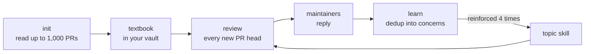

<h1 align="center">revuto</h1>

<p align="center">
  <b>A PR reviewer that runs on your machine and learns how your team reviews.</b>
</p>

<p align="center">
  <a href="https://github.com/avifenesh/revuto/actions/workflows/ci.yml"></a>
  <a href="https://github.com/avifenesh/revuto/actions/workflows/codeql.yml"></a>
  <a href="https://www.npmjs.com/package/revuto"></a>
  <a href="LICENSE"></a>
</p>

Point revuto at a GitHub repo. It reads the repo's PR history, writes down what
your maintainers care about, and reviews every new PR with that knowledge. When
maintainers reply to its comments, it learns. Feedback that keeps coming back
becomes a reusable skill.

## Why revuto

- **Learns your repo.** It builds a textbook from up to 1,000 past PRs and keeps
  adding to it from every review thread.
- **Runs on the plan you already have.** Claude, ChatGPT, Gemini, GLM, Grok, a
  local model or Amazon Bedrock. Mix them per PR size.
- **Lives on your machine.** One daemon, a local store, and an optional GitHub App
  for review-on-push.
- **Knowledge you can read.** Skills are markdown notes in an Obsidian vault, or
  any folder. Nothing is written into the reviewed repo.
- **Careful with your code.** Claude and Codex reviewers get read-only tools over
  the PR checkout: no shell, no network tools, no GitHub token. Revuto posts the
  review itself.

## Quick start

```bash
npm i -g revuto            # Node 22 or newer
revuto init-config         # writes ~/revuto/revuto.config.json
```

Pick a reviewer from the next section and put it in `models.review`. Then:

```bash
export GH_TOKEN=ghp_...    # or: gh auth login
revuto doctor              # checks models, store and GitHub token
revuto init owner/repo     # clone, read PR history, write the textbook
revuto daemon              # review, learn and decay on schedule
```

The default memory store is [SurrealDB](https://surrealdb.com): start it with
`scripts/surreal-start.sh`. For no extra dependencies, set
`"store": { "backend": "sqlite" }`.

## Bring your own plan

| you have | revuto runs | sign in with |
|---|---|---|
| Claude Pro or Max | Claude Code | `claude setup-token`, then `CLAUDE_CODE_OAUTH_TOKEN` |
| a ChatGPT plan | Codex | `CODEX_HOME=~/.config/revuto/codex codex login` |
| an Anthropic API key | Claude Code | `ANTHROPIC_API_KEY` |
| an OpenAI API key | Codex | `OPENAI_API_KEY` |
| a Google account | Gemini through Antigravity | the `agy` login |
| the Z.ai coding plan | GLM | `ZAI_API_KEY` |
| Grok | Grok | the Grok CLI login or `GROK_API_KEY` |
| a GPU | llama.cpp, vLLM, Ollama or any OpenAI-compatible server | nothing |
| AWS, Google Cloud or Azure | Claude on Bedrock, Vertex or Foundry; GPT on Bedrock | your cloud credentials |

A reviewer on your Claude plan:

```json
{ "api": "claude", "baseURL": "claude-cli://local", "auth": "subscription", "model": "claude-opus-5-5", "reasoningEffort": "high" }
```

On your ChatGPT plan:

```json
{ "api": "codex", "baseURL": "codex://openai", "auth": "subscription", "model": "gpt-6.1-sol", "reasoningEffort": "high" }
```

Mix them. Big PRs go to Claude, small ones to Codex, Gemini curates skills and GLM
distills PR history:

```jsonc
"models": {
  "review":      { "api": "claude", "baseURL": "claude-cli://local", "auth": "subscription", "model": "claude-opus-5-5", "reasoningEffort": "high",
                   "fallbacks": [{ "api": "codex", "baseURL": "codex://openai", "auth": "subscription", "model": "gpt-6.1-sol", "reasoningEffort": "high" }] },
  "reviewSmall": { "api": "codex", "baseURL": "codex://openai", "auth": "subscription", "model": "gpt-6.1-sol", "reasoningEffort": "medium" },
  "curator":     { "api": "agy", "baseURL": "agy://local", "auth": "agy-oauth", "model": "gemini-4-argon-high",
                   "fallbacks": [{ "baseURL": "https://api.z.ai/api/coding/paas/v4", "model": "glm-5.3", "apiKeyEnv": "ZAI_API_KEY" }] },
  "distill":     { "baseURL": "https://api.z.ai/api/coding/paas/v4", "model": "glm-5.3", "apiKeyEnv": "ZAI_API_KEY" },
  "embedder":    null
}
```

Claude Code and Codex run the review tiers. The curator and distiller run on any
HTTP model or Antigravity. The embedder is optional; without one, dedup and skill
selection fall back to an LLM judge and area globs.

Every provider, its isolation and its knobs: [docs/providers.md](docs/providers.md).

## How it works



- **init** clones the repo, scans its structure, backfills up to 1,000 PRs,
  distills what maintainers care about and writes
  `<vault>/skills/<repo>/_textbook.md`.
- **review** claims the exact PR head, checks it out, picks the textbook and the
  relevant skills, runs the reviewer, then posts a review or skips. A webhook
  triggers it; a cron pass catches anything missed.
- **learn** reads replies to revuto's comments, filters noise and dedups them into
  concerns. A concern reinforced four times graduates into a topic skill.
- **decay** ages out concerns that never graduate.

New skills land as `draft` and load only after `revuto approve`. Repos with
`autoActivate` graduate them as `active` right away.

## Review on push

Polling works with no public endpoint. For reviews within seconds of a push,
install one GitHub App on the accounts you want covered and point its webhook at
the daemon. Each PR head gets a `revuto-review` check: a clean review passes it and
approves that exact head, and findings fail it. Setup, a Tailscale Funnel recipe,
and the self-healing webhook monitor: [docs/github-app.md](docs/github-app.md).

## Reviews that fit the PR

- **Three tiers.** Docs-only and small PRs go to `models.reviewSmall`, mid-size ones
  to `models.reviewMedium`, the rest to `models.review`. Risky paths and learned
  hotspots always get the large tier. Routing costs no model call.
- **Re-reviews look at what changed** since revuto's last reviewed head.
- **A round cap** (3 by default) stops endless review and fix loops. After the cap,
  `revuto review owner/repo 123 --final` runs one last review of the head that
  will merge.

Tiers, escalation, shadow sampling and exit codes: [docs/reviews.md](docs/reviews.md).

## Commands

```bash
revuto doctor                        # verify endpoints + GitHub token first
revuto init <owner/repo> [maxPRs]    # onboard a repo (clone + backfill + textbook)
revuto daemon                        # start scheduler + configured GitHub App webhook

# lifecycle
revuto add <owner/repo>              # register without onboarding
revuto remove <owner/repo> [--purge] # unregister (--purge also deletes skills + sqlite memory)
revuto pause <owner/repo>            # stop scheduling (until resume / restart)
revuto resume <owner/repo>           # re-enable scheduling
revuto cron <owner/repo> <job> <expr>  # per-repo cron for review|learn|decay ("clear" resets to default)
revuto list                          # list registered reviewers (shows PAUSED)

# run a job now
revuto trigger <owner/repo> [job]    # run review|learn|decay now (default: review)
revuto review <owner/repo> <pr>      # review one specific PR now (exit 0 passed, 2 concerns, 3 not run, 1 failed)
revuto review <owner/repo> <pr> --final  # one review of the current head after review.maxRounds
revuto learn <owner/repo>            # run one learn pass now
revuto decay <owner/repo>            # run decay now
revuto approve <owner/repo> <slug>   # activate a draft skill
```

## Configuration

Config, skills and reviewer notes live together in the vault (`~/revuto`, or
`$REVUTO_VAULT`), so you can read and edit all of it in Obsidian. No secrets are
stored there: API keys and the webhook secret are referenced by environment
variable name. Optional daily caps on reviews, learn passes and tokens bound the spend.

Config keys, storage backends, limits, the local dashboard and systemd units:
[docs/configuration.md](docs/configuration.md).

## Development

```bash
git clone https://github.com/avifenesh/revuto && cd revuto
npm install && npm run build
npm run typecheck
npm test
npx tsx scripts/smoke/graduation.ts    # store + 4× graduation + selection
npx tsx scripts/smoke/loop.ts          # full learn loop (fake endpoint)
npx tsx scripts/smoke/responses.ts     # /v1/responses + Bedrock Mantle auth
npx tsx scripts/smoke/doctor.ts        # doctor probes + output shape
npx tsx scripts/smoke/config.ts        # config defaults + model API validation
npx tsx scripts/smoke/webhook.ts       # GitHub webhook HMAC + dispatch/check outcomes
npx tsx scripts/smoke/scheduler.ts     # registry + schedule planning
npx tsx scripts/smoke/scan.ts          # onboarding repo scan
```

## License

[MIT](LICENSE)
